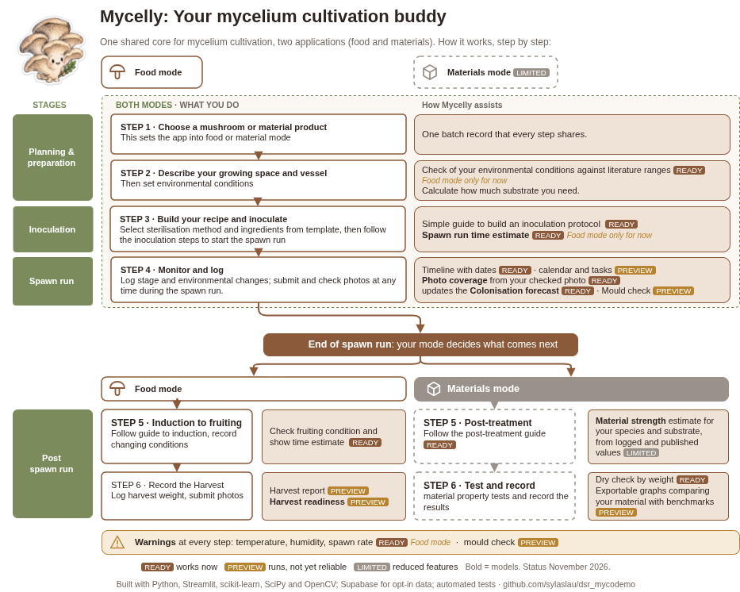

# Mycelly: your mycelium cultivation buddy (demo)

Applied mycology is an emerging field that offers sustainable solutions, and the diversity of its applications means that research and development progress largely in parallel. Experts in food science, agriculture, materials science and environmental engineering each design experiments according to their own professional conventions and standards. Therefore, a substantial body of data exists, but it cannot be readily combined or compared.

For this demo project, I explore how data science can harmonise these heterogeneous parameters and processes into a comparable dataset, and how machine learning tools built on such shared data could accelerate cross-disciplinary R&D towards sustainable solutions for the circular bio-economy.

[](https://mycelly-demo.streamlit.app/)



## Run locally

Prerequisite: [uv](https://docs.astral.sh/uv/). It installs the required Python version (3.13) if needed.

```bash
curl -LsSf https://astral.sh/uv/install.sh | sh   # install uv, if not yet installed
uv sync                                            # install dependencies
uv run streamlit run dsr_mycodemo/app/Welcome.py   # start the app
uv run pytest -q                                   # optional: run the tests
```

## Good to know

This is an early-stage demo. Its estimates rest on a small set of published sources and a single test batch; they show that the pipeline works end to end, not that the models are validated. Model design and performance are described in the project write-up (link to follow).

## About

Built by Sylas Lau ([@sylaslau](https://github.com/sylaslau)), a plant biologist with a background in materials science and horticulture, to promote interdisciplinary research on mycelium and to advocate applied mycology for a circular bio-economy.

Licence: MIT, see [LICENSE](LICENSE). Sources and credits: [THIRD_PARTY_NOTICES.md](THIRD_PARTY_NOTICES.md).
